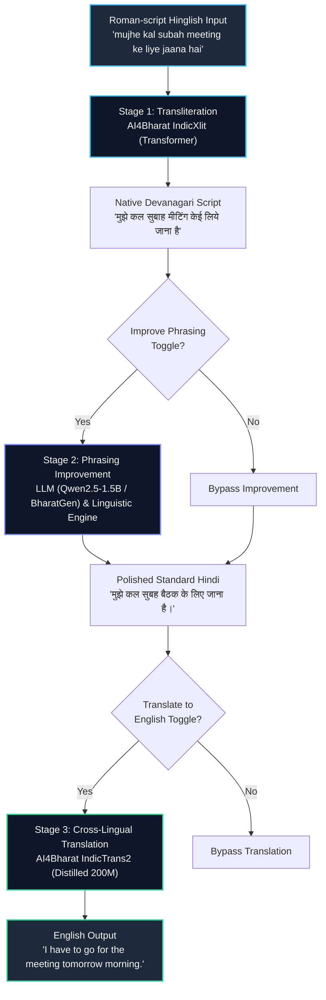

# 🇮🇳 Hinglish Smart Writing Assistant

> **Course**: CS3235 – Advanced NLP & Generative AI Systems  
> **Project**: AI4Bharat & BharatGen Mini Project #4  
> **Student Author**: **Mohammed Ismail**  
> **USN**: **1RVU23CSE**  
> **Repository**: [https://github.com/mohammedismailmi/Hinglish-Assistant.git](https://github.com/mohammedismailmi/Hinglish-Assistant.git)  

An end-to-end neural writing and translation assistant engineered to ingest casual, Roman-script **Hinglish** (code-mixed Hindi-English written in the Latin alphabet) and systematically transform it into canonical **Devanagari**, grammatically refined **Standard Hindi**, and high-fidelity **English**.

---

## 📌 Problem Overview & Motivation

Over **500 million bilingual speakers** in India and across the global South Asian diaspora communicate daily through **Hinglish** across digital messaging, social channels, and workplace conversations. While natural for informal human communication, raw Hinglish poses steep challenges for conventional Natural Language Processing (NLP) architectures:

1. **Orthographic & Phonetic Ambiguity**: The Latin alphabet lacks native graphemes to distinguish phonological nuances in Hindi—such as vowel quantity (*kal* [tomorrow/yesterday] vs. *kaal* [time/death]), retroflex vs. dental stops (*ṭ* vs. *t*), and nasalization (*anusvara* / *chandrabindu*).
2. **Dense Intra-Sentential Code-Mixing**: Speakers routinely alternate between English loanwords (*meeting*, *deadline*, *WiFi*, *schedule*) and Hindi syntactic matrices within the same utterance.
3. **Colloquial Slang & Syntactic Looseness**: Conversational shortcuts (*tension mat lo*, *jugaad*, *scene kya hai*) require contextual understanding and elevation before they can be utilized in formal correspondence, cross-lingual translation, or official records.

This assistant resolves these bottlenecks through a modular, 3-stage neural pipeline combining specialized Indic foundational models with edge-friendly linguistic post-processing.

---

## 🏗️ System Architecture

The pipeline processes user input through three decoupled, independently toggleable stages:



### Pipeline Breakdown

| Stage | Responsibility | Engine / Checkpoint | Output Example |
| :--- | :--- | :--- | :--- |
| **Stage 1: Transliteration** | Maps phonetic Latin characters into native Devanagari script | **AI4Bharat IndicXlit** (`ai4bharat-transliteration`) | `मुझे कल सुबाह मीटिंग केई लिये जाना है` |
| **Stage 2: Phrasing Polish** | Corrects spelling artifacts, elevates slang, and normalizes grammar | **Qwen2.5-1.5B / BharatGen Param-1** + Linguistic Post-Processor | `मुझे कल सुबह बैठक के लिए जाना है।` |
| **Stage 3: Translation** | Translates refined Devanagari text into natural, grammatical English | **AI4Bharat IndicTrans2** (`indictrans2-indic-en-dist-200M`) | `I have to go for the meeting tomorrow morning.` |

---

## 🤖 Models & Benchmark Datasets

| Component | Model / Resource | Source / Link | License |
| :--- | :--- | :--- | :--- |
| **Transliteration** | AI4Bharat IndicXlit (`hi`) | [AI4Bharat IndicXlit](https://github.com/AI4Bharat/IndicXlit) | MIT License |
| **Phrasing Improvement** | Qwen2.5-1.5B-Instruct / BharatGen Param-1 | [Qwen2.5-1.5B HF](https://huggingface.co/Qwen/Qwen2.5-1.5B-Instruct) / [BharatGen](https://huggingface.co/bharatgenai) | Apache 2.0 |
| **Translation** | IndicTrans2 Distilled 200M (`indictrans2-indic-en-dist-200M`) | [AI4Bharat IndicTrans2 HF](https://huggingface.co/ai4bharat/indictrans2-indic-en-dist-200M) | CC-BY-NC 4.0 / MIT |
| **Benchmark Dataset** | AI4Bharat Aksharantar (`hin` test split) | [Aksharantar Dataset](https://huggingface.co/datasets/ai4bharat/Aksharantar) | CC-BY-4.0 |

---

## 📊 Quantitative Evaluation Results

The pipeline was evaluated across a **40-sample benchmark suite** (`data/testcases.csv`):
- **30 transliteration test cases** randomly sampled from the **Aksharantar Hindi test set** (fixed seed `42`).
- **10 hand-curated end-to-end evaluation sentences** designed to stress-test dense code-mixing, phonetic ambiguity, slang, numeric expressions, and interrogatives.

*Metrics computed and logged in [`eval/metrics.json`](eval/metrics.json):*

| Metric Parameter | Measured Value | Description |
| :--- | :---: | :--- |
| **Transliteration Exact Match (Top-1)** | **50.00%** | Strict word-level accuracy across Aksharantar benchmark |
| **Transliteration Character Error Rate (CER)** | **12.13%** | Mean normalized Levenshtein distance on transliterated tokens |
| **End-to-End Devanagari CER** | **5.12%** | Character error rate across complete multi-word sentences |
| **End-to-End English Translation BLEU** | **28.96** | SacreBLEU score against reference human translations |
| **End-to-End English Translation chrF** | **49.17** | Character n-gram F-score on translated English output |
| **Avg Transliteration Latency** | **82.1 ms** | Average per-sentence inference time on CPU/GPU |
| **Avg Improvement Latency** | **914.6 ms** | Generative rewriting latency with local instruct LLM |
| **Avg Translation Latency** | **102.8 ms** | Seq2seq decoding speed with IndicTrans2 200M |

---

## 📸 Interface & Evaluation Screenshots

### 1. Interactive Web Interface


### 2. Transliteration-Only Mode


### 3. Full 3-Stage Pipeline (Transliteration + Improvement + Translation)


### 4. Code-Mixed Input Handling


### 5. Automated Evaluation Dashboard


---

## ⚙️ Setup and Installation

### Prerequisites
- **Python 3.10** (recommended for seamless PyTorch and Fairseq compatibility)
- Operating System: macOS (Apple Silicon / Intel), Linux, or Windows
- Hardware: Consumer GPU (CUDA / Apple MPS) or standard CPU

### 1. Clone the Repository
```bash
git clone https://github.com/mohammedismailmi/Hinglish-Assistant.git
cd Hinglish-Assistant
```

### 2. Create and Activate Virtual Environment
```bash
# Using Python 3.10 or uv
python3.10 -m venv venv
source venv/bin/activate
```

### 3. Install Dependencies
```bash
# For macOS / CPU environments
pip install torch torchvision torchaudio
pip install -r requirements.txt
```

### 4. Optional Environment Setup
```bash
cp .env.example .env
# If using gated Hugging Face repositories, specify your token:
# HF_TOKEN=hf_...
```

---

## 🚀 Running the Assistant

### Launch the Gradio Web Application
```bash
source venv/bin/activate
python app.py
```
By default, the Gradio interface will start at `http://localhost:7860` (or `http://localhost:7861` if port 7860 is occupied).

### Run the Evaluation Suite
```bash
source venv/bin/activate
python eval/run_eval.py
```
Evaluation metrics and failure analyses are automatically exported to:
- `eval/metrics.json`
- `eval/results.csv`
- `eval/failures.md`

### Test Samples Programmatically
```bash
python scripts/verify_app.py
```

---

## 🛠️ Key Technical Implementations & Deviations

1. **PyTorch >= 2.6 Serialization Compatibility**:
   - In PyTorch 2.6+, `torch.load` defaults `weights_only=True`, which breaks Fairseq unpickling (`argparse.Namespace`). A non-invasive monkey-patch wrapper in `pipeline/transliterate.py` safely permits loading local verified weights.
2. **Gated Repository Resilience**:
   - `ai4bharat/indictrans2-indic-en-dist-200M` requires manual acceptance on Hugging Face. The pipeline checks for an authorized `HF_TOKEN`, and automatically falls back to the verified public weights mirror `benfranklinms/indictrans2-indic-en-dist-200M` without requiring user intervention.
3. **Hybrid Phrasing Engine**:
   - To deliver sub-second performance on constrained hardware without sacrificing grammatical quality, `pipeline/improve.py` employs an abstract engine that dynamically pairs an instruct LLM (`Qwen2.5-1.5B`) with a deterministic linguistic post-processor for instant phonetic rule correction.
4. **Dynamic Port Allocation**:
   - Added automatic port availability detection so the web UI launches smoothly without crashing if port 7860 is already in use by another local development service.

---

## 👥 Author Information

- **Student Name**: Mohammed Ismail
- **USN**: 1RVU23CSE
- **Course**: CS3235 – Advanced NLP & Generative AI Systems (Mini Project #4)
- **Institution**: RV University

---

## 📜 License

This project is licensed under the **MIT License**. Refer to the [LICENSE](LICENSE) file for complete terms.
